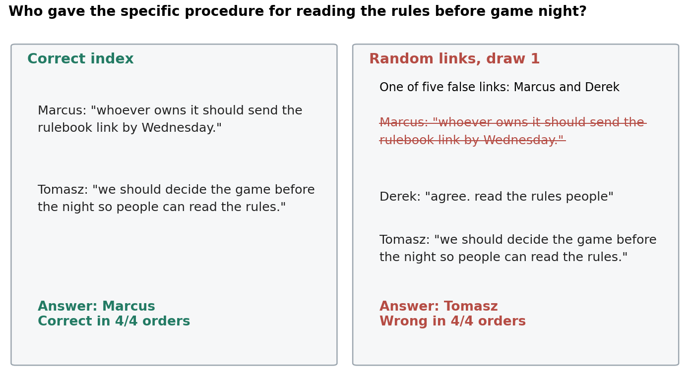

# Tracing False Speaker Links: a stage audit for LLM memory

False links between people can change a memory system's answers while its average accuracy changes little. This tool compares saved records to show where the changes occur.

This repository contains the offline `stage_audit` tool and the memory error card from the paper *Tracing False Speaker Links Through Retrieval and Answering* (Dev D. Goyal, NORA Workshop at AACL-IJCNLP 2026).



## What the paper found

Memory systems for LLM agents can organize past conversations by person, for example in a speaker index or a knowledge graph. Building such an index requires entity resolution, which can wrongly link two people. The paper adds false links at known rates to a retrieval pipeline, keeps every message and name unchanged, and follows 280 questions from search to answer.

- With one false link per 40 people, almost one in four workplace searches reaches a wrong person.
- At the highest tested rate, gpt-oss-120b reads a different context in 81.0% of workplace runs, but its accuracy falls by only 1.75 percentage points, because improved and worsened answers offset each other.
- Under random links at the highest tested rate, five of 80 social questions carry all gpt-oss losses. One question carries 79% of history-weighted loss.

## What is in this repository

| Path | Contents |
| --- | --- |
| `src/stage_audit/` | The offline audit tool. It uses only the Python standard library and makes no model or network calls. |
| `docs/stage_audit.md` | The input record format and the definitions of every measure. |
| `examples/stage_audit/` | A small worked example with its expected output. |
| `docs/memory_error_card.pdf` | The memory error card for the paper's pipeline: nine measures to report beside accuracy. |
| `docs/memory_error_card_template.pdf` | A blank card for your own system. |
| `tests/` | Tests for the tool. |

The tool reports shortlist changes, context changes, semantic answer transitions,
and agreement with no-memory answers. It can also compare reached-person and
reference-ID sets. It does not calculate every measure on the card. Evidence
coverage, loss concentration, and repeated-request analysis need additional
records and analysis. The [record reference](docs/stage_audit.md) defines the
outputs and their limits.

## Quick start

Tested with Python 3.13 and 3.14.

```bash
PYTHONPATH=src python -m stage_audit \
  --baseline examples/stage_audit/baseline.jsonl \
  --changed examples/stage_audit/changed.jsonl \
  --no-memory examples/stage_audit/no_memory.jsonl \
  --answer-key examples/stage_audit/answer_key.jsonl
```

Compare the output with `examples/stage_audit/expected.json`. To audit your own pipeline, write one JSONL record per question, option order, and draw for each condition, as `docs/stage_audit.md` describes.

You can also install the tool and run it as `stage-audit`:

```bash
pip install .
stage-audit --help
```

## Report a memory error card

When you test a change to a memory system, report these measures beside accuracy:

1. **Exposure:** searches that reach a new person.
2. **Context change:** pairs with different delivered text.
3. **Evidence displacement:** labeled messages gained and lost.
4. **Churn:** gains, losses, and other answer changes, not only the net change.
5. **Conditional change:** loss among correct baseline answers and gain among incorrect ones.
6. **Loss concentration:** how many questions carry the losses.
7. **Index headroom:** the intact component against its removal.
8. **No-memory agreement:** stable answers that equal the no-memory answer.
9. **Repeated requests:** answer changes under identical input.

Use `docs/memory_error_card_template.pdf` as the form.

## Citation

```bibtex
@inproceedings{goyal2026falsespeakerlinks,
  title     = {Tracing False Speaker Links Through Retrieval and Answering},
  author    = {Goyal, Dev D.},
  booktitle = {Proceedings of the NORA Workshop (Knowledge Graphs and Agentic Systems Interplay) at AACL-IJCNLP 2026},
  year      = {2026}
}
```

## License

MIT. See `LICENSE`.
